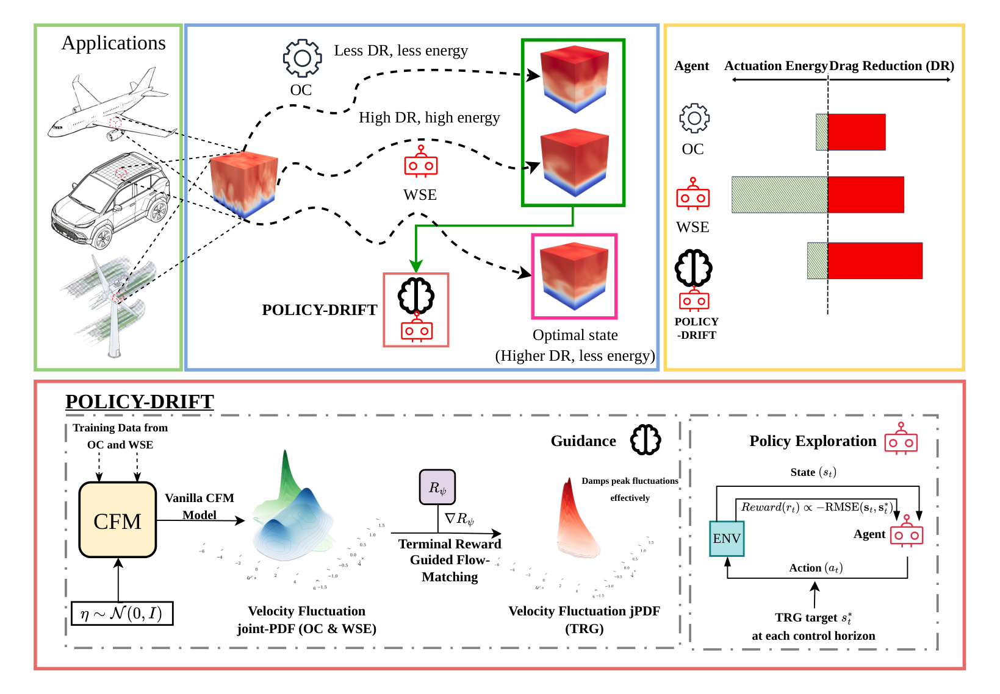

# Policy-DRIFT: Dynamic Reward-Informed Flow Trajectory Steering

Code, checkpoints and initial conditions for

> Atharva Mahajan, Abhijeet Vishwasrao, Yuning Wang, Ricardo Vinuesa.
> *Policy-DRIFT: Dynamic Reward-Informed Flow Trajectory Steering.* [arXiv:2605.14022](https://arxiv.org/abs/2605.14022), 2026.



Policy-DRIFT moves the reward out of the policy gradient and into generative inference:

1. A **conditional flow matching (CFM)** model learns the distribution of the flow state Δt⁺ = 5 ahead,
   p(u₁ | u₀), from uncontrolled, opposition-controlled and TD3-WSE-controlled DNS of a minimal turbulent
   channel at Re_τ = 180.
2. **Terminal Reward Guidance (TRG)** steers the CFM ODE toward high-reward terminal states with the
   gradient of a learned reward predictor R_ψ.
3. A **TD3 policy** tracks the TRG target by minimising the RMSE between the flow field and the target,
   which is refreshed every 8 actions.

In the paper, Policy-DRIFT reaches 48.95% drag reduction on held-out initial conditions, against 42.13% for
the TD3 controller trained on the drag reduction itself, with about 37× less actuation energy.

## Repository layout

```
Policy-DRIFT/
├── checkpoints/          trained CFM model, reward predictor and DRL policies used in the paper
├── data/                 DNS restart files, normalisation statistics and sample snapshots
├── flow_matching_trg/    CFM velocity model, reward predictor and TRG sampler (package `trg`)
├── drl_pipeline/         Dedalus channel DNS, multi-agent environment, training and evaluation (package `drl`)
├── scripts/              Table 1 statistics from evaluation outputs
└── docs/                 method figure
```

Every directory has its own README with the details.

## Installation

The DNS uses [Dedalus 2](https://dedalus-project.readthedocs.io) with MPI, installed from conda-forge.
Everything else comes from pip. The code is tested with the versions in `requirements.txt` (Python 3.11).

```bash
conda create -n policy-drift -c conda-forge python=3.11 dedalus=2.2207.3 mpi4py=3.1.4
conda activate policy-drift
pip install -r requirements.txt
pip install -e .
```

Check that MPI works in this environment:

```bash
mpirun -n 2 python -c "from mpi4py import MPI; print(MPI.COMM_WORLD.Get_rank())"
```

## Quick start

These runs check an installation in a few minutes.

```bash
# Flow matching side: two epochs of CFM and reward-predictor training on data/sample (CPU or GPU)
cd flow_matching_trg
python train_cfm.py --dummy
python train_trg.py --dummy

# DRL side: two 20-action episodes of Policy-DRIFT on a 2 x 2 DNS process mesh (9 MPI processes)
cd ../drl_pipeline
python train.py --reward trg --dummy
```

## Evaluating the trained controllers (Table 1)

Each evaluation runs one policy from the six held-out initial conditions in `data/eval` for t⁺ ≈ 3000
(4,920 actions). It needs 65 MPI slots (one agent process and 64 DNS ranks) and takes about 20 minutes
per initial condition on 64 cores.

```bash
cd drl_pipeline
python evaluate.py --model ../checkpoints/drl/policy_drift_td3.zip
python evaluate.py --model ../checkpoints/drl/td3_wse.zip
python evaluate.py --model ../checkpoints/drl/td3_wen.zip
cd ..
python scripts/table1.py drl_pipeline/outputs/evaluation/*
```

On a SLURM cluster, submit the same commands with `drl_pipeline/slurm/evaluate.sbatch`. The simulations
are bitwise reproducible on the 8 × 8 process mesh with the versions in `requirements.txt`.

Table 1 of the paper (drag reduction in %, E_act × 10, R̄ = DR − E_act):

| Method        | DR mean | DR std | E_act mean | E_act std | R̄     |
|---------------|--------:|-------:|-----------:|----------:|------:|
| Policy-DRIFT  | 48.95   | 11.70  | 0.0990     | 0.0711    | 0.480 |
| TD3-WEN       | 42.86   | 11.77  | 0.0609     | 0.0406    | 0.423 |
| TD3-WSE       | 42.13   | 12.71  | 3.692      | 0.0431    | 0.052 |

The opposition-control and SAC-WSE rows of Table 1 are not part of this release; SAC-WSE can be retrained
with `python train.py --reward wse --algo sac`.

## Training from scratch

The stages run in order; each stage reads the checkpoint of the previous one from `checkpoints/`
unless told otherwise.

| Stage | Command | Hardware | Output |
|---|---|---|---|
| Snapshot data | `cd drl_pipeline && python generate_snapshots.py --control none\|opposition\|<policy>` | 65 CPU cores per regime | `data/cfm/<regime>/` |
| CFM velocity model | `cd flow_matching_trg && python train_cfm.py` | 1 GPU | `flow_matching_trg/outputs/cfm/best.pt` |
| TRG reward predictor | `python train_trg.py cfm_checkpoint=<cfm best.pt>` | 1 GPU | `flow_matching_trg/outputs/trg/best.pt` |
| Policy-DRIFT agent | `cd drl_pipeline && python train.py --reward trg` | 129 CPU cores | `drl_pipeline/outputs/td3_trg_seed24_gs5/` |
| Baselines | `python train.py --reward wse`, `--reward wen`, `--reward wse --algo sac` | 129 CPU cores | `drl_pipeline/outputs/<run>/` |

The TD3-WSE regime of the snapshot data is controlled by `checkpoints/drl/td3_wse.zip` or by a policy trained
with `python train.py --reward wse`; see [data/README.md](data/README.md). To train the agent with newly
trained models, point `trg.velocity_model` and `trg.reward_predictor` in `drl_pipeline/configs/channel.yml`
to them.

## Citation

```bibtex
@article{mahajan2026policydrift,
  title   = {Policy-{DRIFT}: Dynamic Reward-Informed Flow Trajectory Steering},
  author  = {Mahajan, Atharva and Vishwasrao, Abhijeet and Wang, Yuning and Vinuesa, Ricardo},
  journal = {arXiv preprint arXiv:2605.14022},
  year    = {2026}
}
```

## Acknowledgements

The interface between the agent and the Dedalus solver was originally developed by Miguel Beneitez
(KTH Royal Institute of Technology). This research was sponsored by the Army Research Office under
Grant Number W911NF-26-1-A053.
